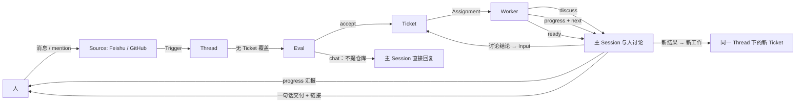

# 009 Personal agent

本文回答一个问题：把这套 dsh-superagent 改造成面向单个用户（而不是一个团队、一个仓库）的 personal agent，主 Session 要更 responsive——更主动地向人汇报进展、和人讨论，并根据新结果继续派发 Executor——架构应当怎样设计，而且尽量精简。

本文只陈述架构与取舍，不重复 [000 Philosophy](000-philosophy.md) 到 [008 Cookbook](008-cookbook.md) 已经定义的概念。凡是本文没有提到的概念、工具、存储字段与状态，保持原样。

## 问题

读者从真实运行数据中读到的现象（2026-11-01，stateDir 中一个多小时内 16 条 Trigger、4 个 Ticket）：

| 观察 | 今天的机制 | 结果 |
| --- | --- | --- |
| 人连发「在吗」「在不在」「好的」「在哪」 | 每条都是一次 Eval；闲聊不是任何 rule，ignore 的 Decision 不发消息；只有写仓库的任务才会产生消息 | 人觉得「没人理」 |
| 「你有名字吗」这类问题 | Eval 只有 accept（开 Ticket 干活）和 ignore（不回）两个出口，没有「回复但不开工」 | 同样没有回应 |
| 一个 Ticket 15 分钟内没有任何消息 | `prompts/work.md` 要求进展「保持内部」，`reportRelay` 把不带 `answers` 的 `progress` 直接丢掉（`src/app/notices.ts`） | 人不知道发生了什么 |
| 「检查结果出来我第一时间发给您」 | 承诺取决于 Worker 自己记得发 `progress`，host 不跟踪 | 承诺了也不会兑现 |
| 人被要求等待（「正在做，稍后汇报」） | 有 `progress` 状态，但它是「内部更新」，主 Session 收到也默认不说话 | 主 Session 没有正当渠道兑现一句「还在做」 |

根因不在模型不够热情，而在三处角色定义：

1. **主 Session 被定义成 router。** `prompts/orchestrator.md`：评估与派发；评估之外不读代码、不查日志、不讨论，只做一次 ACK 和最后交付一句话。
2. **Worker 被定义成 silent executor。** `prompts/team/communication.md`：「Default to silence while working」「Keep progress reports … internal」。
3. **汇报权限与汇报义务绑定在 Ticket 生命周期上，而不是消息上。** `orchestrator_reply` 的 `result` 要 Ticket ready，`attention` 要当前有 attention 结构，`answer` 要有引用的人类问题。于是「还在做」（progress）和「先问你一句」（临时提问）都没有合法出口。

因此「更 responsive」= **承认「对话」是一等公民**，并给它一条有不打扰铁律的窄通道。

## 设计原则

- **通信与授权正交。** 一条消息的权利只取决于它是「交流」还是「开工」，以及它的依据；与产物、预算、Ticket 的大小无关。交流不需要 Ticket，也不能顺带授权任何动作。
- **人设门槛，不设频率。** 允许更主动，但「什么时候该说话」仍是写死的铁律：每条消息必须过三问（改变什么 / 是否用户问题的新答案 / 是否用户当时在等）；没有变更就不发第二条；进度必须带可验证证据（文件、路径、命令、链接），否则写进工作日志。
- **只有一种「分叉」概念。** 新结果带来新工作，沿用 Ticket 的 `Input` 与 `Attachment`，不新增 Task / Spawn / FollowupTicket。
- **新增状态只有一个枚举值。** `ReportState` 增加 `discuss`，其余 Report 状态、Ticket 阶段、Assignment 语义全部复用。
- **每个改动都要能用数据验收。** 不达标就回滚到「沉默」，不靠加更多状态补救。

## 架构

### 角色

| 角色 | 今天 | personal agent |
| --- | --- | --- |
| 主 Session | Router：评估候选、派 Ticket、转发 Worker 的结构化问题；不讨论 | **主 Agent**：评估、派工，并与人对话；可拉上下文、可上报进展、可讨论方向 |
| Executor（Worker） | 静默执行，只在 ready/blocked/failed 出声 | 不变：静默执行；但 `discuss` 可把「方向分叉」交给主 Agent 去谈，Worker 不直接聊 |

Worker 保持静默是为了保持注意力与上下文双重成本低：讨论的上下文留在主 Session，Worker 的上下文只装实现细节。

### 概念

设计只用已有序章概念 + 一个枚举值：

| 概念 | 今天含义 | personal agent 用法 | 不新增的理由 |
| --- | --- | --- | --- |
| Thread | 时间序 Trigger，Subscribe 的单位 | 人的一条对话线（一个 Feishu 会话、一个话题）承载整个工作流 | 已有，天然就是「会话」 |
| Ticket | 一段被授权的工事 | 一次任务；同一个 Thread 下可有多个 Ticket，形成任务序列 | 已有，天然就是「并列任务」 |
| Mandate | 授权依据 | 人直接提出问题 → `strength=explicit`；讨论 → 新的 `via` 取值 `discussion` | 不加「对话身份」概念，只是记住依据 |
| Channel | Thread 的写侧 | `progress` / `result` / `attention` / `ack` / `answer` 之外，允许 `discuss`（讨论与进展汇报） | 已有通道，只是多一个用途 |
| Input | 投递给 Ticket 的上下文 | 新结果 → 新的 `progress` Report → 如带 `next` 建议，作为 `text` Input 追加回 Ticket；`cascade` 字段声明受影响文件的范围，避免无界扩张 | 复用已验证的 Input 语义 |
| ReportState | progress/ready/blocked/failed/dropped | 增加 `discuss`（Worker 认为需要与人商定方向）；`progress` 从内部改成「可上报进展」 | 单值扩展，无新表 |
| Project | 一个仓库工作区 | Source 支持多 repository；一个 Project ≈ 一个 Source 实例 | Source 已能做「一类流的一份配置」，多仓库 = 多实例 |

### 流程图

### 数据流细节

1. **Eval 多一个出口：`chat`。** 一条消息若没有仓库工作意图、但指向主 Agent（mention / direct），Eval 记 `chat` Decision，主 Session 直接回复（一句），不开 Ticket、不写仓库。语料因此从「只有 accept / ignore」变成三条路。实测「你有名字吗」走这条。
2. **Worker 的 `progress` 上报。** 一小时内至多一条 `progress`：带证据的进展 → 主 Session 看后一句话送人；超过一小时仍无结论 → 主 Session 主动问 Worker 一句（用现有 `orchestrator_ticket_request_status`），把「待在 X 上继续、下次更新在 Y」告诉人。
3. **新结果 → 讨论 → 新工作。** Worker 的 `progress` 可带 `next`（建议的下一步，附依据）。主 Session 在人愿意接受的前提下把它作为 `text` Input 或一段新 `accept` 回放进 Ticket 或同 Thread 的新 Ticket；`note` 限额沿用现有 100 词与「事实不是授权」的约束。Worker 在 `next` 中声明受影响文件范围（`cascade`），若范围扩大到另一个模块，则不能自行派发，必须回到人。
4. **讨论没有 Ticket 也能进行。** 讨论由主 Session 直接完成；讨论结论若要落地，按现有流程开 Ticket。这让讨论的成本为「主 Session 一轮对话」，不需要 Ticket / Worker 资源。
5. **优先级与预算。** 主 Session 的「讨论」与「汇报」不占 Worker 槽位；同一时间只跑一个 Worker（`maxWorkers=1` 即可满足个人用户），会话节奏由主 Session 的单点调度决定。

## 主要改动

按风险从低到高排列，每一档都能独立验收并回滚。

### M0：不打扰契约（先做，零架构改动）

- 在 `prompts/team/communication.md` 顶部增加「通知三问」与「无变更不发第二条」；`prompts/work.md` 把「保持内部」改为「有带证据的进展时发 `progress`，主 Session 一句话上报」。
- 验收标准（自动化/半自动）：
  - 同一 Ticket 在 24 小时内的非 `ready` 消息 ≤ N（默认 3）；超出视为噪音，需回滚。
  - 有明确的「对话轮次」不占用 Worker 槽。
- 风险：写死规则后模型可能仍不遵守；因此这条先跑一周，再进入 M1。

### M1：主 Session 拥有「对话」工具（架构小改动）

- 新增 `orchestrator_chat`（或把 `orchestrator_reply` 扩一个 `purpose: 'discussion'`）：
  - 允许在未改代码、未认领 Ticket 时回人一句话；
  - 参数：`thread`、`text`（≤100 词）、可选 `link`（PR / 文件 / 命令输出）。
  - 宿主强制：主 Session 调用一次后 30 秒内不能再对同一条消息发第二条（幂等 + 限频），从机制上保证「不打扰」。
- Eval 增加 `chat` Decision：`kind: 'chat'`，只允许「无仓库工作意图」的消息；有实现意图一律走 accept。
- 风险：`chat` 会被误用为「假装做事」；因此 `chat` 与 `accept` 在 Decision 里分开记账，面板可看「聊天 / 开工」的比例。

### M2：Progress + 讨论回灌（架构中改动）

- `ReportState` 增加 `discuss`：Worker 在「方向分叉、需人拍板」时发出，主 Session 读到后主动开聊，并把结论以 `text` Input 回放给 Worker。
- `progress` 从「内部」升级为「主 Session 收到后一句话转述」：`reportRelay` 仍不把普通 `progress` 当结果转发，而是在 M0 的通告契约里要求 Worker 的进展自带 `evidence`，带 `evidence` 的 `progress` 才进入主 Session 的 inbox，由主 Session 按三问决定是否发声；没有证据的 `progress` 继续只留在 Ticket 记录里。这样噪音上限由「有没有证据」决定，而不是由模型心情决定。
- `progress` 的 payload 增加 `evidence`、`next` 与 `cascade`（证据、建议的下一步、受影响文件范围），供主 Session 决定是否上报、是否开新 Ticket。
- 验收指标：
  - 一个 Ticket 从 accept 到 ready 期间，人至少收到一次带证据的进展（或明确说明「预计 X 时间」）。
  - 讨论结论 100% 回到 Ticket 或新 Ticket，不丢结论。
- 风险：讨论可能发散、超预算。对策：主 Session 的 `chat` 有 100 词上限与 30 秒限频；超出一轮仍无结论时，回 fallback——把问题记成 `attention` 交给用户拍板。

### M3：多仓库（可选，后续）

- Source 支持多 repository：一个 `github` 实例监听多个仓库；Project 概念只在需要时与 Source 实例绑定，不引入新表。
- 风险：授权范围（谁能读哪个仓库）需要在 Policy 中显式；先只做「同一 owner 的多仓库」。

## 取舍

| 方案 | 做法 | 取舍 |
| --- | --- | --- |
| A：只改 prompt | M0 | 零架构改动，但无法兑现「讨论结论回流」「progress 上报」，模型仍可能静默 |
| B：M0 + M1 | 复用现有 Thread、Channel、Decision | 改动最小、可回滚；但「新结果派发新 Worker」仍要人手动提，不够顺 |
| C：M0–M2（推荐） | 上面全部 | 概念只多一个枚举值，主 Session 成为对话主体；需要实现 `discuss` 生命周期（保持已有「Progress 在前」原则） |
| D：重写成多进程 worker / 多 Agent 框架 | 全部重写 | 与 000 Philosophy「Few concepts」冲突，成本远超个人用户需要 |

## 执行器 Worker 与主 Agent 的分工

- 主 Agent：记忆、讨论、判断、派工、汇报。它读的是**摘要**（Report 的 `summary`、Ticket 的 `latestReport`），不是完整 transcript；这是它保持「轻」的关键。
- Worker：实现、验证、发 PR。它不直接和人聊，`discuss` 是它唯一的「挂起交接」出口。
- 两者共享同一份 State（Ticket 是唯一持久化边界），主 Session 重启不丢人设与对话记录。

## 长期保存的「记忆」

- 对话（人说的话）→ `trigger` 表（已存在）；
- 讨论结论 → `decision`（已存在）；
- Worker 交接与进度 → `assignment` report（已存在，增加 `discuss`）；
- 无需为 memory 新增表：主 Session 需要「记得聊过什么」时，读 Thread 的 Trigger 与 Ticket 列表即可。

## 验收与度量

| 指标 | 目标 | 数据来源 |
| --- | --- | --- |
| 人发消息后首次回应时延 | 闲聊 ≤ 1 分钟；开工 ≤ 2 分钟 | trigger 与 outbox 时间差 |
| 24h 内每 Ticket 非 `ready` 消息数 | ≤ 3（可调） | outbox 按 ticketId 统计 |
| 「沉默 ticket」比例 | 从 100% 降到 ≤ 10% | 有进展上报的 Ticket 占比 |

## 参考

以下项目与本文的问题同类（多 Agent / Orchestrator 派发 / 个人化 Agent），只作对照阅读，本文的设计不依赖它们的具体实现：

- DeepSeek Harness 官方多 Agent 设施：subagent、`agent-team` 团队插件、workflow 脚本编排（参见社区对 DSH 源码的盘点：[多 Agent 协作思考与设计](https://blog.csdn.net/qq_45637001/article/details/164030512)、[递归 planner 到冲突治理](https://blog.csdn.net/weixin_35755823/article/details/166778857)）。
- Orchestrator + Worker 的分工范式：OpenAI Codex 的 orchestrator 模式（[codex-orchestrator](https://github.com/bohdankordon/codex-orchestrator)）、[agent-orchestrator](https://github.com/Xhwe-x/agent-orchestrator)。
- 研究侧证据：Orchestrated multi-agent 在临床规模负载下的效果对比，说明「编排者只做派发与汇总」在长任务上仍有效（[npj Health Systems](https://www.nature.com/articles/s44401-026-00077-0)）。

本文也参考了 DeepSeek 公开的 super-agent 架构讨论（[官方公告](https://zhuanlan.zhihu.com/p/2100019747622602327)）；其中尚未实现的方向与本仓库的 `docs/` 一致，本文不重复。

## 交付方式

这不是一份只放在仓库里的文档。PR 合入后，把上面的「问题」「架构」「M0–M2」三节整理成一页 HTML（单文件、离线可开、含 Mermaid 静态图或等价的 SVG 流程图），以文件消息发回发起对话（Feishu 会话 `oc_ebd18231768e21b0905ebfcb33b311ec`），让读者不用翻仓库就能读完整方案；HTML 的正文使用中文，术语保留 `docs/001` 的英文名以免歧义。
